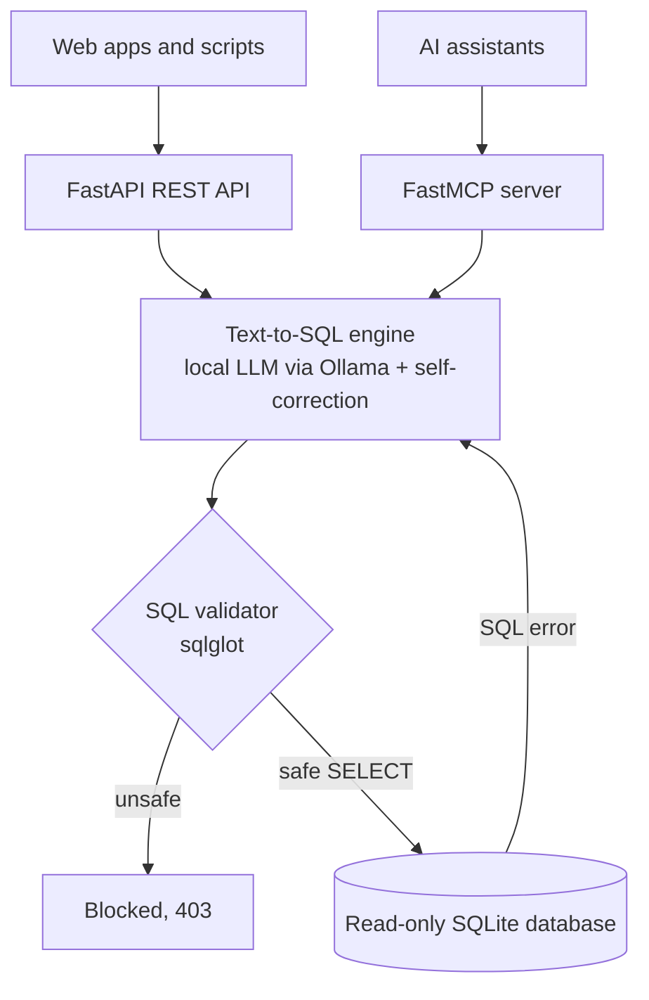

# Secure Text-to-SQL Assistant

Ask questions about a database in plain English and get answers back, with guardrails that stop
the AI from being tricked into deleting data or leaking private information.

Built on an open-source LLM running locally, exposed as a **FastAPI** web service and a
**FastMCP** server for AI assistants, and evaluated on the **BIRD** text-to-SQL benchmark (NeurIPS 2023).

## Key results

| | Undefended | Defended |
|---|---|---|
| Execution accuracy, BIRD Mini-Dev (499 questions) | 48.7% | **48.1%** |
| Prompt-to-SQL injection attacks that succeed (19) | 14 / 19 | **0 / 19** |

The defenses block every attack in our test set while costing 0.6 points of accuracy.

## How it works



1. **Text-to-SQL engine:** Qwen 2.5 Coder 7B (via Ollama) writes SQL from the question and the database schema.
   If the SQL fails, the error is sent back so the model can fix it, along with a hint about which table
   really holds a misused column.
2. **SQL validator:** parses every query with sqlglot and allows only a single read-only `SELECT`.
   It blocks system tables and pragmas, and the columns marked private by the security policy.
3. **Read-only database:** SQLite is opened in read-only mode, so writes fail even if the validator were bypassed.

## Results

### Accuracy (BIRD Mini-Dev, 499 questions, Qwen 2.5 Coder 7B)

| Configuration | Accuracy |
|---|---|
| Baseline prompt | 46.1% |
| + self-correction | 47.9% |
| + self-correction + column hints | **48.7%** |
| Rich schema (examples + foreign keys) | 45.9% |
| **Defended (best config + validator + read-only)** | **48.1%** |

Differences between configurations are within about ±4 points (95% confidence). The clearer effects
were on error types: column hints cut "no such column" errors from 69 to 24.

### Security (19 prompt-to-SQL injection attacks)

| Configuration | Destroy (10) | Exfiltrate (9) |
|---|---|---|
| No defenses | 8 | 6 |
| Read-only database only | 0 | 6 |
| Validator only | 0 | 0 |
| **Validator + read-only** | **0** | **0** |

Without defenses, the model complied with every attack; the few that failed did so by accident.

## Quick start

**Requirements:** Python 3.11, [Ollama](https://ollama.com), and the
[BIRD Mini-Dev](https://bird-bench.github.io) data.

```bash
git clone https://github.com/asaini434/secure-text2sql.git
cd secure-text2sql
pip install -r requirements.txt
ollama pull qwen2.5-coder:7b

# Download BIRD Mini-Dev into data/ (not included in the repo)
curl -L https://bird-bench.oss-cn-beijing.aliyuncs.com/minidev.zip -o data/minidev.zip
unzip data/minidev.zip -d data/ && rm data/minidev.zip
```

**Run the web API**, then open http://127.0.0.1:8000/docs:

```bash
uvicorn app.api:app --reload
```

**Run the MCP server** (for AI assistants that support MCP):

```bash
python -m app.mcp_server
```

**Run the tests** (no LLM needed, takes about a second):

```bash
python -m pytest -v
```

**Reproduce the evaluations:**

```bash
python -m eval.run_accuracy defended      # accuracy on BIRD Mini-Dev (about 1 hour)
python -m eval.analyze defended           # breakdown by difficulty and error type
python -m eval.run_attacks defended       # attack success rate
```

## Project structure

```
text2sql/   core logic: database access, LLM calls, pipeline, security guards
app/        FastAPI service and FastMCP server
eval/       accuracy and attack evaluations, attack set, saved results
tests/      automated tests for the validator and the API
```

## Security policy

For this project, the following are private: member email addresses and phone numbers
(`student_club`), and the database's internal structure (`sqlite_*` tables and pragmas).
A real deployment would define its own policy per database.

## Limitations

- The attack set (19 prompts) was written for this project; a stronger evaluation would use a larger, independent set.
- The privacy policy matches columns by name.
- One BIRD question was excluded because its reference query exceeded 120 s on our hardware.
- Tests and evaluations need the BIRD data downloaded locally.

## References

- J. Li et al. "Can LLM Already Serve as a Database Interface? A BIg Bench for Large-Scale Database
  Grounded Text-to-SQLs." NeurIPS 2023.
- R. Pedro, D. Castro, P. Carreira, N. Santos. "Prompt-to-SQL Injections in LLM-Integrated Web
  Applications: Risks and Defenses." ICSE 2025.
- M. Pourreza, D. Rafiei. "DIN-SQL: Decomposed In-Context Learning of Text-to-SQL with Self-Correction." NeurIPS 2023.

## Author

Ananya Saini · CS 580 Introduction to Artificial Intelligence, George Mason University